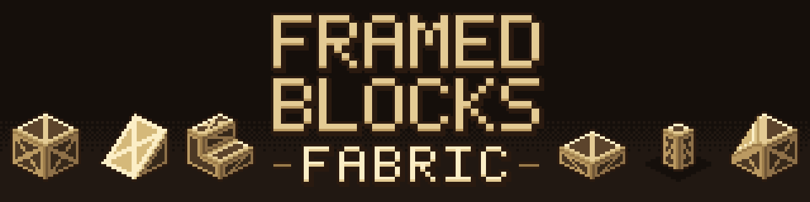

<p align="center">
  
</p>

# FramedBlocks Fabric (Unofficial)

> **This is an unofficial, community port.** It is not affiliated with and not endorsed by the original author, XFactHD. Please report problems with this port in [this repository](https://github.com/navrelis/FramedBlocks-Fabric/issues), not to the upstream project.

FramedBlocks Fabric is a port of [FramedBlocks](https://github.com/XFactHD/FramedBlocks) by XFactHD (upstream version 10.5.3, NeoForge) to the Fabric mod loader for Minecraft 1.21.1. FramedBlocks adds "framed" versions of many block shapes. A framed block starts out as an empty wooden frame and can be given the appearance of almost any other block, which makes it useful for building with shapes that vanilla Minecraft does not offer in every material.

## Features

The following is taken from the registered content and language file of this port (upstream version 10.5.3 plus the shapes listed under "New in 1.1.0").

- **Over 230 framed block shapes.** The block registry contains 269 blocks: 232 framed shapes that have an item, 35 further framed blocks without an item of their own (wall-mounted variants of torches, signs, the banner and corner slope panels, vertical half slopes, waterloggable pressure plates and a few multi-part blocks, which are produced by the item of another shape), the Framing Saw and the Powered Framing Saw. Shapes include cubes, slabs, panels, slopes, stairs, corner and prism pieces, pillars, slope edges, slope panel/slab corners, pyramids, checkered and layered variants, collapsible blocks and double blocks.
- **Fixed in 1.1.2:** Placing or using framed blocks no longer crashes the game with NeoForge-on-Fabric layers such as Sporran (AbstractMethodError caused by conflicting default methods). All block hooks that NeoForge also defines now have concrete implementations.
- **Fixed in 1.1.1:** Framed blocks and items no longer crash the game in modpacks. Three crashes are fixed: Sodium 0.8 together with a mod that wraps block models (such as Continuity), Continuity on its own (a framed block without camo could recurse on its own model), and mods that add NeoForge block methods to vanilla blocks (NeoForge-on-Fabric layers such as Sporran). If another mod's model throws while its quads are read, the mod now logs one warning and uses the plain quads instead of crashing.
- **New in 1.1.0: 28 new framed shapes.** 12 are backported from newer upstream FramedBlocks versions: slope edge slab, slope edge panel, small and large prism corner slope panels (outer and inner), half board, divided board, corner board, inner corner board, double corner board and the framed banner (placed on a wall it becomes the wall banner). 16 are new in this port: arch, inner arch, crown molding with inner and outer corner, octagonal pillar, window frame, table, chair, stool, diagonal brace, corbel, wall shelf, barrel (27 slots), crafting table and redstone lamp (emits light level 15 when powered).
- **Functional blocks:** doors, iron doors, trapdoors, gates, fences, walls, ladders, levers, buttons, pressure plates, signs and hanging signs, torches, lanterns, flower pots, item frames, bookshelves, chests, hoppers, secret storage, tanks, bars, panes, a lightning rod, a target block, a bouncy cube, a redstone block, rails and rail slopes.
- **Camouflage ("camo").** Right-click a framed block with a suitable block item to apply that block's appearance (the framed block also takes over the sound of the camo block). Fluids can also be applied as a camo. Blocks with block entities and untagged non-solid blocks are rejected. A Framed Hammer removes the camo again. Whether the camo item is consumed is a server config option.
- **Tools:** Framed Hammer (toggle per-block options such as waterlogging, and remove camo), Framed Wrench (rotate blocks and switch some shape variants), Framed Screwdriver (rotate the camo texture), Framed Key (lock the state of a block), Framed Blueprint (copy a framed block including its camo; the required materials must be in the inventory).
- **Block upgrades:** glowstone dust makes a framed block emit light, Framed Reinforcement reinforces it (removed again with a pickaxe that can mine obsidian), Phantom Paste makes it intangible (server config option).
- **Framing Saw:** converts framed blocks into other framed shapes using a material-value system, with a searchable recipe screen. A Powered Framing Saw is included. By default it works without energy (server config option `poweredSawRequiresEnergy`, default `false`). If Team Reborn Energy is installed, other mods can insert energy into the saw from every side except the top; the saw never outputs energy. With `poweredSawRequiresEnergy = true` the saw consumes energy while crafting and does nothing without it.
- **Configuration** for client rendering, overlays, server rules and developer debugging, using the bundled Forge Config API Port.

## Requirements

- Minecraft 1.21.1
- Java 21
- [Fabric Loader](https://fabricmc.net/use/) 0.19 or newer
- [Fabric API](https://modrinth.com/mod/fabric-api)
- Forge Config API Port is bundled with the mod and does not need to be installed separately.
- Optional: Team Reborn Energy (mod id `team_reborn_energy`, the common energy API on Fabric, used for example by Tech Reborn) for energy input of the Powered Framing Saw. It is not bundled.

The mod has to be installed on both the client and the server.

## Installation

1. Install Fabric Loader for Minecraft 1.21.1 and Fabric API.
2. Download the mod jar and place it in the `mods` folder of the client and, for multiplayer, of the server.
3. Start the game.

## Compatibility

Integrations with the following mods are optional and only active if the respective mod is installed:

JEI, REI, EMI, Jade, Diagonal Blocks, Amendments, Searchables, Additional Placements, AtlasViewer, Team Reborn Energy.

All integrations compile against the respective mod's API for Minecraft 1.21.1 on Fabric. In a world, JEI, REI, EMI and Jade load the FramedBlocks plugin (automated client test). The remaining integrations have not been tested in game yet. Please report problems on the issue tracker.

Not included, because no Fabric build for Minecraft 1.21.1 of these mods exists: Create, Applied Energistics 2, Building Gadgets. Their integrations were removed from the port.

## Differences from the NeoForge original

- Runs on Fabric Loader and Fabric API instead of NeoForge.
- The mod id is `framedblocks_fabric` instead of `framedblocks`. **Worlds and items from the NeoForge version are not compatible** because block and item ids differ.
- Rendering was rebuilt on the Fabric Rendering API.
- NeoForge capabilities (item and fluid handling) were replaced by the Fabric Transfer API.
- Integrations with Create, Applied Energistics 2 and Building Gadgets were removed, including the AE2 Framing Saw Pattern item.
- The Athena integration was removed. Fabric Athena computes connected textures while emitting quads, so there is nothing to forward; camos with connected textures depend on the general model capture instead.
- The Powered Framing Saw uses Team Reborn Energy instead of NeoForge FE energy, and works without energy by default.
- New pixel-art logo.

## Building from source

Requires JDK 17 or newer to start the Gradle wrapper. The Gradle daemon needs JDK 25 (Fabric Loom 1.18), which is provisioned automatically through the Daemon JVM criteria in `gradle/gradle-daemon-jvm.properties`, and the mod itself is compiled for Java 21 through a Java toolchain.

```
./gradlew build
```

On Windows use `gradlew.bat build`. The mod jar is written to `build/libs`. The logo images in `docs/images` can be regenerated with `node tools/logo/generate.mjs`.

`./gradlew build` also runs the game tests (Fabric game test API, test mod in `src/gametest`). `./gradlew runGametest` runs only the game tests. `./gradlew runClientDev` starts a development client with the test mod, which runs a self-test on startup and adds the `/fbtest` developer commands. Test code is never part of the mod jar.

## License and credits

- FramedBlocks is Copyright (C) XFactHD and contributors, licensed under the GNU Lesser General Public License v3.0 ([`LICENSE`](LICENSE), [`LICENSE.GPL`](LICENSE.GPL)).
- The Fabric port is Copyright (C) 2026 navrelis, licensed under the same license.
- The bundled Forge Config API Port by Fuzs is licensed under the MPL-2.0.
- See [`NOTICE.md`](NOTICE.md) for details about the modifications.

Original mod: https://github.com/XFactHD/FramedBlocks. Credit for the concept, the content and the original code goes to XFactHD and the upstream contributors.

## Reporting issues

Report bugs of this port at https://github.com/navrelis/FramedBlocks-Fabric/issues. Please include the Minecraft, Fabric Loader, Fabric API and mod versions, the log file and, for rendering issues, the list of other installed mods. Do not report issues of this port to the upstream project.
