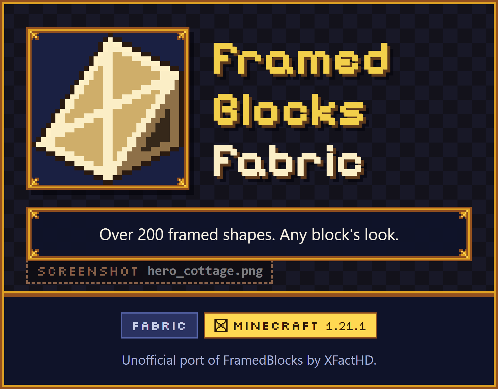

FramedBlocks Fabric is an unofficial port of FramedBlocks by XFactHD to the Fabric mod loader, for Minecraft 1.21.1. It adds framed versions of over 230 block shapes. A framed block starts out as an empty wooden frame and takes on the look of almost any other block, so you can build slopes, corners, panels and many more shapes in any material.

Last updated: October 2026

![Any block, any shape. A new framed block is an empty wooden frame. Two pictures of the same eight framed shapes, among them a slope, stairs and a corner slope: before, empty wooden frames; after, each one has a different camo, such as oak planks, stone bricks, copper, cherry planks and sandstone. Right-click with a block: the framed block takes the look of the block in your hand. Fluids work too. Take it off: the Framed Hammer removes the camo again. Not accepted as camo: blocks with block entities and untagged non-solid blocks.](dist/img/02-camo.png)

Place a framed block and right-click it with a block item: the frame now looks like that block and also uses its sounds. Fluids can be applied the same way. The Framed Hammer takes the camo off again. Blocks with block entities and untagged non-solid blocks cannot be used as a camo.

The block registry of the mod holds 269 blocks. 232 of them are framed shapes with their own item; the rest are 35 framed blocks without an item of their own (wall-mounted variants, vertical half slopes, waterloggable pressure plates and a few multi-part blocks) and the two saws. The shapes range from simple cubes, slabs and panels to slope edges, pyramids and collapsible blocks.

Double blocks combine two framed parts in the space of one block, for example two slabs or two panels, and every part can take a different camo.

Use glowstone dust on a framed block to make it emit light. A camo that emits light, such as glowstone, also makes the framed block glow. Fluids work as a camo as well.

![Framed blocks that work. A picture of framed functional blocks with wood and stone camos: a sign with text, an item frame holding a Framed Hammer, a door, a button, a wall torch, a lever, a chest, a flower pot with a poppy, a pressure plate, two rail slopes, a fence gate and three lanterns. Doors, iron doors, signs, hanging signs, item frames, lanterns, torches, levers, flower pots and bars, each shown with its item. Also: trapdoors, gates, fences, walls, ladders, buttons, pressure plates, bookshelves, chests, hoppers, secret storage, tanks, panes, a lightning rod, a target block, a bouncy cube, a redstone block, rails and rail slopes.](dist/img/06-functional.png)

Besides building shapes there are framed versions of functional blocks, from doors and signs to chests, hoppers, tanks and rails. They take a camo like any other framed block.

![Tools and upgrades. Each shown with its item. Framed Hammer: removes the camo and toggles options such as waterlogging. Framed Wrench: rotates blocks and switches some shape variants. Framed Screwdriver: rotates the camo texture. Framed Key: locks the state of a block. Framed Blueprint: copies a framed block with its camo; the materials must be in your inventory. Upgrades, each shown with its item: glowstone dust, the block gives off light. Framed Reinforcement: blast resistance of obsidian, and the camo no longer burns; a pickaxe that can mine obsidian removes it. Phantom Paste: the block becomes intangible (server config option).](dist/img/07-tools.png)

Five tools change framed blocks after placing them: the Framed Hammer, Wrench, Screwdriver, Key and Blueprint. Glowstone dust, Framed Reinforcement and Phantom Paste upgrade a single block.

![Switch shapes with the Framing Saw. A picture of the Framing Saw screen: framed cubes in the input slot, the slope recipe selected in the searchable recipe list, framed slopes in the output slot. Framing Saw: turns framed blocks into other framed shapes, by material value. Powered Framing Saw: works without energy by default. With the optional Team Reborn Energy installed, other mods can feed energy into the Powered Framing Saw from every side except the top. It never outputs energy. The server config option poweredSawRequiresEnergy, false by default, makes energy required.](dist/img/08-saw.png)

The Framing Saw converts one framed shape into another using a material-value system, with a searchable recipe screen. The Powered Framing Saw does the same and runs without energy by default.

Ten optional integrations are built in and only switch on when the other mod is installed. Create, Applied Energistics 2 and Building Gadgets are not supported in this port.

Install Fabric Loader 0.19 or newer and Fabric API for Minecraft 1.21.1, then put the mod into the `mods` folder of the game and of the server. Java 21 is required, and Forge Config API Port is already bundled.

## What is FramedBlocks Fabric?

FramedBlocks Fabric is a port of [FramedBlocks](https://github.com/XFactHD/FramedBlocks) by XFactHD (upstream version 10.5.3 for NeoForge) to Fabric Loader and Fabric API on Minecraft 1.21.1. It is an unofficial community port and is not affiliated with or endorsed by XFactHD.

FramedBlocks adds "framed" versions of many block shapes. A framed block starts out as an empty wooden frame and can be given the appearance of almost any other block. That makes it useful for building with shapes that vanilla Minecraft does not offer in every material, like a slope made of deepslate tiles or a panel made of cherry planks.

## How does camouflage work?

The look a framed block takes on is called its camo.

- **Apply a camo.** Right-click a framed block with a suitable block item. The framed block takes over the appearance of that block and also its sound.
- **Fluids.** Fluids can be applied as a camo too.
- **Not accepted.** Blocks with block entities and untagged non-solid blocks are rejected.
- **Remove a camo.** Hit the block with the Framed Hammer.
- **Item use.** Whether the camo item is consumed is a server config option.
- **Double blocks.** Blocks that combine two framed parts in one block space take one camo per part.

## Which shapes are there?

The block registry contains 269 blocks: 232 framed shapes that have an item, 35 further framed blocks without an item of their own (wall-mounted variants of torches, signs, the banner and corner slope panels, vertical half slopes, waterloggable pressure plates and a few multi-part blocks, which are produced by the item of another shape), the Framing Saw and the Powered Framing Saw.

- **Building shapes:** cubes, slabs, panels, slopes, stairs, corner and prism pieces, pillars, slope edges, slope panel and slope slab corners, pyramids, checkered and layered variants, collapsible blocks and double blocks.
- **Fixed in 1.1.1:** Framed blocks and items no longer crash the game in modpacks. Three crashes are fixed: Sodium 0.8 together with a mod that wraps block models (such as Continuity), Continuity on its own (a framed block without camo could recurse on its own model), and mods that add NeoForge block methods to vanilla blocks (NeoForge-on-Fabric layers such as Sporran). If another mod's model throws while its quads are read, the mod now logs one warning and uses the plain quads instead of crashing.
- **New in 1.1.0:** 28 new shapes. 12 are backported from newer upstream FramedBlocks versions: slope edge slab, slope edge panel, small and large prism corner slope panels (outer and inner), half board, divided board, corner board, inner corner board, double corner board and the framed banner (placed on a wall it becomes the wall banner). 16 are new in this port: arch, inner arch, crown molding with inner and outer corner, octagonal pillar, window frame, table, chair, stool, diagonal brace, corbel, wall shelf, barrel (27 slots), crafting table and redstone lamp (emits light level 15 when powered).
- **Functional blocks:** doors, iron doors, trapdoors, gates, fences, walls, ladders, levers, buttons, pressure plates, signs and hanging signs, torches, lanterns, flower pots, item frames, bookshelves, chests, hoppers, secret storage, tanks, bars, panes, a lightning rod, a target block, a bouncy cube, a redstone block, rails and rail slopes.

## Tools and upgrades

| Item | What it does |
|---|---|
| **Framed Hammer** | Removes the camo and toggles per-block options such as waterlogging. |
| **Framed Wrench** | Rotates blocks and switches some shape variants. |
| **Framed Screwdriver** | Rotates the camo texture. |
| **Framed Key** | Locks the state of a block. |
| **Framed Blueprint** | Copies a framed block including its camo. The required materials must be in your inventory. |
| **Glowstone dust** | Makes a framed block emit light. |
| **Framed Reinforcement** | Gives a framed block at least the blast resistance of obsidian and makes its camo non-flammable. A pickaxe that can mine obsidian removes it again. |
| **Phantom Paste** | Makes a framed block intangible. This is a server config option. |

## Framing Saw and Powered Framing Saw

The Framing Saw converts framed blocks into other framed shapes using a material-value system. Its recipe screen is searchable.

The Powered Framing Saw works without energy by default. If Team Reborn Energy is installed, other mods can insert energy into the saw from every side except the top. The saw never outputs energy. The server config option `poweredSawRequiresEnergy` (default `false`) controls whether energy is needed: with `true`, the saw consumes energy while crafting and does nothing without it.

## Configuration

FramedBlocks Fabric has config files for client rendering, overlays, server rules and developer debugging. They use Forge Config API Port, which is bundled with the mod.

## What do I need to install?

| What | Version |
|---|---|
| **Minecraft** | 1.21.1 |
| **Java** | 21 |
| **Fabric Loader** | 0.19 or newer |
| **Fabric API** | the version for Minecraft 1.21.1 |
| **Forge Config API Port** | bundled, nothing to install |
| **Team Reborn Energy** | optional, only for energy input of the Powered Framing Saw (not bundled) |

The mod has to be installed on both the client and the server.

## How do I install it?

1. Install Fabric Loader for Minecraft 1.21.1 and Fabric API.
2. Put the mod jar into the `mods` folder of the client and, for multiplayer, of the server.
3. Start the game.

## Which mods does it work with?

These integrations are optional and only active if the other mod is installed: JEI, REI, EMI, Jade, Diagonal Blocks, Amendments, Searchables, Additional Placements, AtlasViewer and Team Reborn Energy.

All integrations compile against the API of the other mod for Minecraft 1.21.1 on Fabric. In a world, JEI, REI, EMI and Jade load the FramedBlocks plugin (automated client test). The remaining integrations have not been tested in game yet. Please report problems on the [issue tracker](https://github.com/navrelis/FramedBlocks-Fabric/issues).

Not included, because no Fabric build of these mods exists for Minecraft 1.21.1: Create, Applied Energistics 2 and Building Gadgets. Their integrations were removed from the port.

## Differences from the NeoForge original

- Runs on Fabric Loader and Fabric API instead of NeoForge.
- The mod id is `framedblocks_fabric` instead of `framedblocks`. **Worlds and items from the NeoForge version are not compatible**, because the block and item ids differ.
- Rendering was rebuilt on the Fabric Rendering API.
- Item and fluid handling uses the Fabric Transfer API instead of NeoForge capabilities.
- The integrations with Create, Applied Energistics 2 and Building Gadgets were removed, including the AE2 Framing Saw Pattern item.
- The Athena integration was removed. Camos with connected textures rely on the general model capture instead.
- The Powered Framing Saw uses Team Reborn Energy instead of NeoForge energy, and works without energy by default.
- New pixel-art logo.

## Frequently asked questions

### Is this the official FramedBlocks?

No. FramedBlocks is made by XFactHD for NeoForge. FramedBlocks Fabric is an unofficial community port to Fabric by Navrelis. It is not affiliated with or endorsed by XFactHD.

### Can I open a world from the NeoForge version?

No. The port uses the mod id `framedblocks_fabric` instead of `framedblocks`, so blocks and items from the NeoForge version do not carry over.

### Does it work on servers?

Yes. Install it on the server and on every client. The mod is required on both sides.

### Can I use water or other fluids as a camo?

Yes. Fluids can be applied to a framed block like a block item.

### Is the camo block used up?

That depends on the server config. Whether the camo item is consumed is a server config option.

### Does the Powered Framing Saw need energy?

Not by default. With Team Reborn Energy installed, other mods can feed it energy, and the server option `poweredSawRequiresEnergy` makes energy required.

### Does it work with Create or Applied Energistics 2?

No. Those integrations were removed from the port, because no Fabric builds of Create, Applied Energistics 2 or Building Gadgets exist for Minecraft 1.21.1.

### Where do I report bugs?

At the [issue tracker of the port](https://github.com/navrelis/FramedBlocks-Fabric/issues). Please include the Minecraft, Fabric Loader, Fabric API and mod versions, the log file and, for rendering issues, the list of other installed mods. Do not report bugs of this port to the upstream project.

## Credits

FramedBlocks Fabric is an **unofficial port of [FramedBlocks](https://github.com/XFactHD/FramedBlocks)** by **XFactHD**. All credit for the concept, the content and the original code goes to XFactHD and the upstream contributors.

This port is **not affiliated with or endorsed by XFactHD**. Report bugs of the port to the [port's issue tracker](https://github.com/navrelis/FramedBlocks-Fabric/issues), not to the upstream project.

- **Original mod:** [FramedBlocks on GitHub](https://github.com/XFactHD/FramedBlocks) and [on CurseForge](https://www.curseforge.com/minecraft/mc-mods/framedblocks), by XFactHD
- **Fabric port:** Navrelis
- **Source of the port:** [https://github.com/navrelis/FramedBlocks-Fabric](https://github.com/navrelis/FramedBlocks-Fabric)
- **Issues:** [https://github.com/navrelis/FramedBlocks-Fabric/issues](https://github.com/navrelis/FramedBlocks-Fabric/issues)
- **License:** LGPL-3.0. The bundled Forge Config API Port by Fuzs is MPL-2.0.
